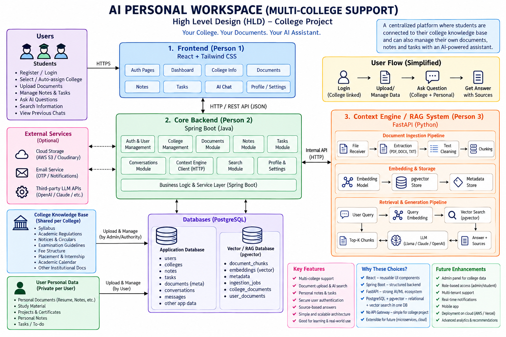
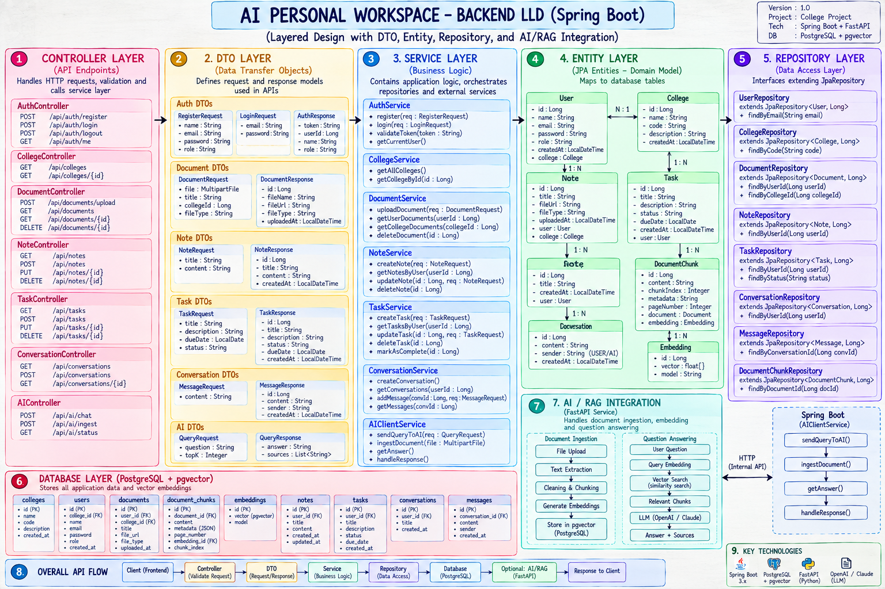
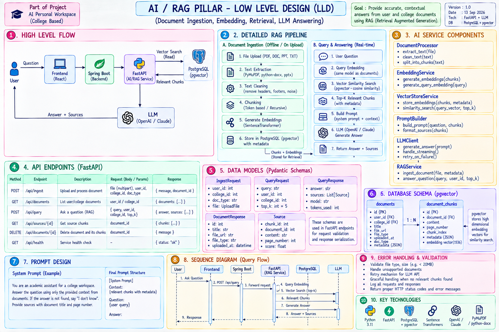
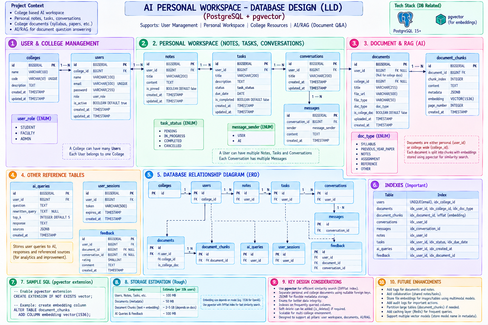
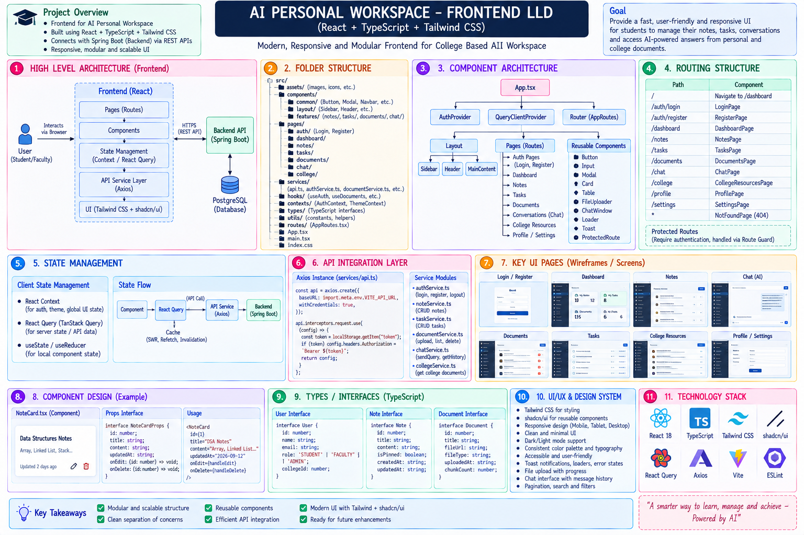

# AI Personal Workspace

> **AI-powered personal workspace for college-scoped knowledge, private user knowledge, productivity, and source-grounded AI assistance.**

## 🚀 Project Status

**Current Phase:** 🟢 **Development Started**

The planning and architecture phase is now complete. The project's **HLD, LLD, database design, frontend architecture, backend architecture, and AI/RAG architecture** have been finalized.

The project has now moved from **design → implementation**.

### ✅ Architecture Complete
- HLD finalized
- Backend LLD finalized
- AI/RAG LLD finalized
- Database design finalized
- Frontend LLD finalized
- Technology stack finalized

### 🔨 Development In Progress
Implementation of the **Frontend, Spring Boot Backend, PostgreSQL Database, and AI/RAG Service** is now underway.

### 🎯 Immediate Goal

Build and integrate the first end-to-end working flow:

**User → Frontend → Backend → AI/RAG → Database → Response**

---

# 1. Project Overview

AI Personal Workspace is designed to bring a user's academic and personal information into one workspace.

The application combines:

- College/institution knowledge
- Personal documents
- Notes
- Tasks
- Conversations
- AI-powered question answering
- RAG-based retrieval with sources

The main goal is not simply to build another chatbot. The goal is to build a **context-aware workspace** in which the AI can answer using information that the current user is actually allowed to access.

---

# 2. Main Focus

The project has four technical pillars:

1. **Frontend** — user interaction and workspace UI
2. **Backend** — authentication, authorization, business logic, APIs
3. **AI/RAG** — document processing, retrieval, and grounded AI responses
4. **Database** — persistent application data and vector knowledge

These pillars are shown in the uploaded architecture diagrams.

---

# 3. Core Product Idea

The application maintains two important knowledge scopes.

### College-scoped knowledge

Information that can be shared by users belonging to the same college.

Examples:

- Syllabus
- Academic rules
- Examination information
- Academic calendar
- Placement information
- Internship guidelines
- College notices

### User-private knowledge

Information belonging only to the individual user.

Examples:

- Resume
- Personal study material
- Private PDFs
- Project documents
- Personal notes

The system must keep these scopes separate.

Conceptually:

```text
College Knowledge
       |
   college_id
       |
       +---- Authorized College Users

Personal Knowledge
       |
     user_id
       |
       +---- Only That User
```

This separation is one of the most important design decisions in the project.

---

# 4. Why This Architecture?

The architecture is intentionally designed for a college project and learning purpose.

It provides clear separation between:

- User interface
- Application/business logic
- Data persistence
- AI/RAG processing

At the same time, it avoids unnecessary complexity such as:

- API Gateway
- Load Balancer
- Kubernetes
- Large-scale microservice decomposition
- Service discovery

The current system is therefore easier to understand, implement, test, and explain during a college project presentation.

---

# 5. Architecture Documentation

## 5.1 High-Level Design

The uploaded **HLD image** is the primary reference for the overall system architecture.

It explains:

- Major system components
- Communication between components
- Four technical pillars
- External services
- Application database
- AI/RAG service
- Overall request/data flow

### HLD image




---

# 6. Low-Level Design Documentation

The project has separate LLD diagrams for the four pillars.

These diagrams should remain as individual images because each one represents a different implementation responsibility.

## 6.1 Backend LLD

The backend LLD shows the internal Spring Boot structure.

Its purpose is to explain the separation between:

- Controller
- DTO
- Service
- Entity
- Repository
- Database

The important implementation principle is:

```text
HTTP Request
     ↓
Controller
     ↓
Request DTO
     ↓
Service / Business Logic
     ↓
Entity
     ↓
Repository
     ↓
Database
```

DTOs are kept separate from entities so that database models are not directly exposed as API contracts.

### Backend LLD image



---

## 6.2 AI/RAG LLD

The AI/RAG LLD explains two separate flows:

### Document ingestion

```text
File
 ↓
Text Extraction
 ↓
Cleaning
 ↓
Chunking
 ↓
Embedding
 ↓
Vector Storage
```

### Question answering

```text
User Question
 ↓
Query Embedding
 ↓
Permission/Scope Filtering
 ↓
Vector Retrieval
 ↓
Relevant Chunks
 ↓
LLM
 ↓
Answer + Sources
```

The RAG service is separated from the main Spring Boot application because Python provides a strong ecosystem for document processing, embeddings, vector search, and LLM integration.

### AI/RAG LLD image
 


---

## 6.3 Database LLD

The database LLD is the authoritative visual reference for the database structure.

The database stores both normal application data and RAG-related data.

Important conceptual relationships include:

```text
College → Users
College → College Documents
User → Private Documents
User → Notes
User → Tasks
User → Conversations
Conversation → Messages
Document → Document Chunks
```

The database design must support both:

- Relational application data
- Vector-based retrieval

PostgreSQL is used as the main database, with pgvector for embeddings.

### Database LLD image



---

## 6.4 Frontend LLD

The frontend LLD explains the React application structure.

Major areas include:

- Authentication
- Dashboard
- Documents
- Notes
- Tasks
- AI Chat
- Conversations
- Profile
- Reusable UI components
- API communication
- Application state

The frontend should focus on presentation and user interaction. Authorization decisions must remain on the backend.

### Frontend LLD image



---

# 7. Recommended Repository Documentation Structure

Keep the architecture images separate from the main README:

```text
AI-Personal-Workspace/
│
├── README.md
│
├── docs/
│   ├── architecture/
│   │   ├── HLD.png
│   │   ├── Backend-LLD.png
│   │   ├── AI-RAG-LLD.png
│   │   ├── Database-LLD.png
│   │   └── Frontend-LLD.png
│   │
│   ├── api/
│   ├── database/
│   └── decisions/
│
├── frontend/
├── backend/
├── rag-service/
└── ...
```

This is cleaner than putting every diagram directly into the README.

---

# 8. Technology Stack

| Layer | Technology | Purpose |
|---|---|---|
| Frontend | React | User interface |
| Styling | Tailwind CSS | UI styling |
| Backend | Spring Boot | Main application/API |
| Backend language | Java | Application/business logic |
| Database | PostgreSQL | Persistent relational data |
| Vector storage | pgvector | Embedding storage/search |
| AI service | FastAPI | RAG/AI API |
| AI language | Python | AI/document-processing ecosystem |
| LLM | Llama / Claude or selected provider | Response generation |
| Communication | REST/HTTP | Frontend/backend and backend/RAG communication |

---

# 9. Responsibility of Each Pillar

## Frontend

Responsible for:

- Rendering pages
- User interaction
- Forms
- File upload UI
- Chat UI
- Showing sources
- Calling backend APIs

It should **not** be responsible for deciding whether a user is allowed to access another user's data.

## Backend

Responsible for:

- Authentication
- Authorization
- Business rules
- User/college relationships
- CRUD operations
- API contracts
- Data access
- Calling the RAG service

The backend is the main application layer.

## AI/RAG

Responsible for:

- Extracting document text
- Cleaning text
- Creating chunks
- Generating embeddings
- Searching relevant chunks
- Building context
- Calling the LLM
- Returning answers and sources

## Database

Responsible for:

- Persistent application data
- Relationships
- Constraints
- Document metadata
- Conversation history
- RAG chunks
- Embeddings

---

# 10. Data Access and Security Model

The system follows a simple rule:

```text
Private data
    → user_id

College data
    → college_id
```

For example, if the current user belongs to College A:

```text
Allowed:

College A shared documents
+
Current user's private documents
```

Not allowed:

```text
College B documents
+
Another user's private documents
```

The filtering must happen on the server side and must also be respected by the RAG retrieval process.

---

# 11. Main User Flow

A typical user journey is:

```text
Register
   ↓
Login
   ↓
User identified
   ↓
College association established
   ↓
Dashboard
   ↓
Upload / create / manage data
   ↓
Ask AI
   ↓
Retrieve permitted context
   ↓
Generate grounded answer
   ↓
Show answer + sources
```

---

# 12. Main AI Question Flow

Example:

> "What are the internship eligibility requirements?"

The application should:

1. Receive the question from React.
2. Send the request to Spring Boot.
3. Identify the authenticated user.
4. Determine the user's college.
5. Send the AI request to the internal RAG service.
6. Create a query embedding.
7. Restrict retrieval to permitted college/personal data.
8. Retrieve relevant chunks.
9. Give the retrieved context to the LLM.
10. Generate an answer.
11. Attach source information.
12. Return the result to Spring Boot.
13. Return it to React.
14. Display the answer and sources.

This is the central AI workflow of the application.

---

# 13. Why RAG Instead of Only an LLM?

A general LLM does not automatically know the current private or college-specific information stored inside this application.

For example:

- A college's latest policy
- A specific syllabus
- An uploaded notice
- A user's resume
- A user's private study document

RAG allows the system to retrieve the relevant information first and then use it as context for the LLM.

The objective is therefore:

```text
Question
+
Relevant application knowledge
        ↓
     LLM
        ↓
Grounded answer
+
Sources
```

---

# 14. Why PostgreSQL + pgvector?

PostgreSQL handles the normal application data well:

- Users
- Colleges
- Documents
- Notes
- Tasks
- Conversations
- Messages

pgvector adds vector storage and similarity search.

This allows the project to keep the initial architecture relatively simple instead of introducing a separate vector database immediately.

A dedicated vector database can be considered later if scale or requirements justify it.

---

# 15. Why Spring Boot + FastAPI?

The project uses two specialized backend technologies.

### Spring Boot

Best suited here for:

- Structured application architecture
- REST APIs
- Authentication
- Business logic
- Database integration
- Java-based enterprise development

### FastAPI

Best suited here for:

- Python AI ecosystem
- Document processing
- Embeddings
- Retrieval
- LLM integration
- Lightweight internal AI APIs

This separation keeps general application logic and AI-specific processing independently maintainable.

---

# 16. MVP Scope

The first working version should focus on a small but complete vertical slice.

### Authentication

- Register
- Login
- Protected routes

### College context

- Associate user with a college
- Store college-scoped information

### Personal workspace

- Upload documents
- Create notes
- Create tasks

### AI

- Ingest documents
- Generate embeddings
- Retrieve relevant chunks
- Ask LLM
- Return answer with sources

### Security

- User-private data isolation
- College-level data isolation
- Backend authorization

---

# 17. Development Roadmap

## Phase 1 — Foundation

- Create repository
- Set up frontend
- Set up Spring Boot backend
- Set up FastAPI service
- Configure PostgreSQL
- Configure pgvector
- Create environment configuration

## Phase 2 — Database

- Create tables
- Add relationships
- Add constraints
- Add indexes
- Add RAG-related tables/fields

## Phase 3 — Backend

- Entity layer
- DTO layer
- Repository layer
- Service layer
- Controller layer
- Validation
- Exception handling
- Authentication
- Authorization

## Phase 4 — Frontend

- Routing
- Login/register
- Dashboard
- Documents
- Notes
- Tasks
- AI chat
- Profile
- API integration

## Phase 5 — RAG

- File ingestion
- Extraction
- Cleaning
- Chunking
- Embeddings
- Vector storage
- Retrieval
- LLM integration
- Sources

## Phase 6 — Integration

```text
React
 ↕
Spring Boot
 ↕
PostgreSQL

Spring Boot
 ↕
FastAPI
 ↕
pgvector + LLM
```

## Phase 7 — Testing

- Unit tests
- API tests
- Authentication tests
- Authorization tests
- Data isolation tests
- RAG retrieval tests
- End-to-end tests

---


# 18. Project Development Principle

The project should be developed incrementally.

Do not implement all features simultaneously.

Build one complete flow first:

```text
Login
 ↓
Upload document
 ↓
Store metadata
 ↓
Extract text
 ↓
Chunk
 ↓
Embed
 ↓
Store vector
 ↓
Ask question
 ↓
Retrieve chunks
 ↓
LLM answer
 ↓
Display sources
```

Once this vertical slice works, expand the workspace with notes, tasks, conversations, and additional features.

---

# 19. Future Scope

Possible future improvements:

- Hybrid keyword + vector search
- Reranking
- Better document parsing
- Document versioning
- Automatic college notice ingestion
- Email integration
- Calendar integration
- AI study planner
- AI task generation
- Voice-based AI interaction
- Cloud file storage
- Multiple LLM providers
- Dedicated vector database
- Advanced analytics
- Mobile/PWA client

These are future enhancements and are **not required for the initial MVP**.


---

# 20. Current Status

| Area | Status |
|---|---|
| Project idea | Completed |
| Product scope | Completed |
| Four-pillar architecture | Completed |
| HLD | Completed |
| Backend LLD | Completed |
| DTO/Entity design | Completed |
| Database design | Completed |
| AI/RAG LLD | Completed |
| Frontend LLD | Completed |
| Documentation | Completed |
| Actual implementation | **Starting now** |

---

# 21. Final Vision

The final system should behave like a **personal AI workspace connected to the user's academic environment**.

```text
             COLLEGE KNOWLEDGE
                    +
             PERSONAL KNOWLEDGE
                    +
          NOTES + TASKS + CHATS
                    |
                    v
              AI / RAG ENGINE
                    |
                    v
            GROUNDED AI ANSWER
                    |
                    v
              USER WORKSPACE
```

The central principle remains:

> **College knowledge is shared according to college scope, while personal knowledge remains private to the user.**

This makes the project more than a simple chatbot: it becomes a structured workspace with an AI layer that understands the user's permitted context.
